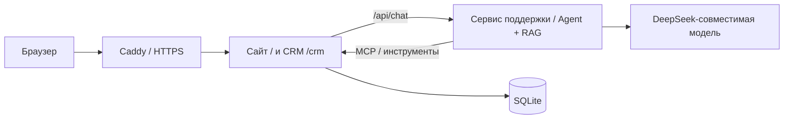

# Развёртывание на VPS

Приложение состоит из двух процессов в отдельных контейнерах: `crm` обслуживает сайт, защищённую CRM и MCP, владеет SQLite; `support` обслуживает чат и обращается к CRM через MCP. `proxy` — необязательный Caddy для публичного HTTPS. Сервис поддержки не открывает БД напрямую и не публикует свой порт наружу.



## Автоматическое развёртывание и публичный адрес

Для свежего VPS рекомендуется **Ubuntu Server 24.04 LTS, 2 vCPU, 4 ГБ RAM и 40 ГБ SSD** с публичным IPv4. Минимум для небольшого демонстрационного стенда — 2 ГБ RAM; 4 ГБ удобнее для сборки образа и запаса. GPU не требуется: модель работает через внешний API. Это инженерная оценка для текущего небольшого стека, а не результат нагрузочного теста.

Загрузите каталог `aiac9` на VPS, сохранив расположение `d33` и `terminal`. В панели хостинга откройте входящий TCP-порт **80**. Скрипт не меняет SSH, не включает новый firewall и не может изменить firewall провайдера.

Из `aiac9/d33` запустите:

```sh
sudo bash deploy/bootstrap-vps.sh
```

Скрипт запросит публичный IPv4 из панели VPS (либо домен), API-ключ и пароль CRM. Секреты вводятся скрыто; межсервисный ключ генерируется автоматически. Секреты не записываются в исходники или файлы окружения; Docker сохраняет настройки контейнеров для их перезапуска. При повторном запуске скрипта ключ API и пароль нужно ввести снова, а volumes и задачи сохранятся.

На свежей Ubuntu 24.04/26.04 скрипт установит Docker, Compose и Buildx из репозиториев Ubuntu, включит запуск Docker при загрузке, соберёт приложения с тестами и запустит CRM, поддержку и Caddy. Если Docker уже есть, установленный стек используется без переустановки. Нужны Compose 2.24+ и Buildx; недостающие плагины на поддерживаемой Ubuntu устанавливаются через apt.

По умолчанию — **HTTP без домена, DNS и сертификатов**. В конце скрипт проверит главную страницу с чатом, `/healthz` и закрытый `/crm`, затем выведет:

```text
Сайт для записи видео: http://ВАШ_ПУБЛИЧНЫЙ_IP/
CRM: http://ВАШ_ПУБЛИЧНЫЙ_IP/crm
Логин CRM: admin; пароль — введённый вами.
```

Проверка выполняется с VPS через его публичный адрес; доступность из браузера также требует открытого порта у провайдера. Если проверка не прошла, скрипт вернёт ошибку и не объявит сайт готовым. Проверка не вызывает модель и не расходует API-кредиты. HTTP подходит для демонстрационного стенда; для передачи реальных данных и пароля CRM включите HTTPS.

Можно задать адрес аргументом:

```sh
sudo bash deploy/bootstrap-vps.sh --address ВАШ_ПУБЛИЧНЫЙ_IP
```

HTTPS со своим доменом (нужны DNS и порты 80/443):

```sh
sudo bash deploy/bootstrap-vps.sh --address garage.example.com --https
```

HTTPS без покупки домена: передайте публичный IPv4 и `--https`. Скрипт использует имя `IP.sslip.io`; DNS и выпуск сертификата зависят от внешнего сервиса. [sslip.io](https://sslip.io/) поддерживает такой DNS и сертификаты отдельных хостов.

Проверка ОС, исходников и ресурсов без установки или запуска:

```sh
bash deploy/bootstrap-vps.sh --check
```

Для отдельного экземпляра с новой БД передайте `--project garage33-video`; порты должны быть свободны. Скрипт не удаляет старые volumes. Ресурсы, пакеты и Linux-окружение проверяются до установки; на macOS скрипт останавливается. Свободного диска нужно минимум 10 ГБ для образов и сборки.

Контейнеры получают healthchecks; прокси запускается после готовности CRM и поддержки. Журналы ограничены тремя файлами по 10 МБ на контейнер, чтобы не росли без ограничений.

Источники для установочного пути: [пакеты Docker в Ubuntu](https://packages.ubuntu.com/search?keywords=docker&suite=noble), [политика обновления стека Ubuntu](https://ubuntu.com/project/docs/SRU/reference/exception-Docker-Updates/). Это пакеты дистрибутива, а не отдельный репозиторий Docker CE.

## Ручная подготовка

На VPS нужны Docker Engine и Compose 2.17+. Ничего из SQLite или Go устанавливать на хост отдельно не требуется: C-компилятор и Go находятся в сборочном образе, драйвер SQLite включён в бинарник. Dockerfile также выполняет Go-тесты и vet при сборке. Два каталога `aiac9/d33` и `aiac9/terminal` должны оставаться рядом; Compose передаёт `terminal` отдельным контекстом сборки.

Не передавайте ключи через build arguments. Задайте `MRKAI_SERVICE_KEY`, `CRM_ADMIN_PASSWORD` и `DEEPSEEK_API_KEY` только в окружении запуска. В README используются placeholders; замените их своими значениями вне исходников. Команды используют `--env-file /dev/null`, поэтому локальные файлы окружения не нужны. Не выводите полный `docker compose config` с реальными значениями.

## Первый запуск

Из `aiac9/d33`, после задания переменных:

```sh
docker compose --env-file /dev/null up -d --build
```

Для предварительного доступа на самом VPS: `http://127.0.0.1:8080/`. CRM: `/crm`, логин `admin`, пароль `CRM_ADMIN_PASSWORD`.

Для домена задайте `SITE_DOMAIN` и направьте DNS A/AAAA на VPS. Укажите только записи, соответствующие его доступным адресам. Caddy получает TLS-сертификат автоматически для указанного домена. Для доступа нужны порты 80 и 443.

```sh
docker compose --env-file /dev/null --profile public up -d --build
```

Сайт: `https://ВАШ-ДОМЕН/`; CRM: `https://ВАШ-ДОМЕН/crm`. CRM закрыта HTTP Basic Auth; изменения проверяют Origin, диалоги посетителей разделены случайным HttpOnly cookie. `/mcp` и внутренние сообщения требуют `MRKAI_SERVICE_KEY`. В Caddyfile не включены журналы HTTP-запросов с личными данными.

## Хранение

- `crm_data`: SQLite `crm.sqlite`, включая таблицы inventory, accounts, messages и tasks.
- `support_data`: RAG-индекс; он пересобирается при запуске сервиса поддержки.
- `caddy_data` и `caddy_config`: состояние HTTPS-прокси.

Обновление образа и обычный перезапуск сохраняют volumes и задачи. Начальные данные добавляются только при отсутствии записи; существующие остатки, статусы и дата ограничения не перезаписываются.

Первый номер ограничен **на московскую дату первого создания БД**. Если приложение работает несколько дней, это ограничение уже истекло — оно намеренно не продлевается при рестарте. Для записи видео со свежими данными можно запускать отдельный экземпляр Compose с именем проекта `garage33-video` (порты должны быть свободны); его volumes будут отдельными.

В БД нет реальных паролей пользователей; состояние доступа не заменяет SMS-аутентификацию. Примеры контактов и запчастей нужно заменить перед использованием для настоящего автосервиса.

## Проверка и обслуживание

```sh
docker compose --env-file /dev/null ps
```

```sh
docker compose --env-file /dev/null logs --tail=100 support
```

Журнал поддержки показывает подключение MCP, обнаружение инструментов, вызовы, шаги модели, создание TODO, ошибки и отмену. Он не содержит текста сообщений, телефонов, ключей, заголовков авторизации или ответов HTTP-ошибок модели.

После изменения документации пересоберите образ и перезапустите поддержку:

```sh
docker compose --env-file /dev/null up -d --build support
```

Обычный перезапуск:

```sh
docker compose --env-file /dev/null restart
```

Для резервной копии остановите `support` и `crm`, затем скопируйте весь каталог данных CRM, включая возможные SQLite WAL/SHM. Например:

```sh
docker compose --env-file /dev/null stop support crm
```

```sh
mkdir -p backup-crm
```

```sh
docker compose --env-file /dev/null cp crm:/app/data/. ./backup-crm
```

```sh
docker compose --env-file /dev/null start crm support
```

Копия содержит переписку и телефоны; храните её в закрытом каталоге. При восстановлении файлы должны быть доступны контейнерному пользователю UID/GID 65532. Удаление volumes удаляет БД, поэтому для обычного обновления его не требуется.

## Ограничения

Рассчитано на один экземпляр `crm` и один `support`: SQLite принадлежит CRM, а последовательность запросов одного диалога защищает сервис поддержки. Масштабирование на несколько реплик потребует общего управления диалогами и подходящей БД. Доска показывает последние 500 задач; подробный контекст загружается при открытии карточки. История чата ограничена последними 60 сообщениями и 24 000 символами, контекст модели — 12 000 символами истории. Нерешённые вопросы автоматически создают задачи, но диагностику и исправление выполняет сотрудник.
